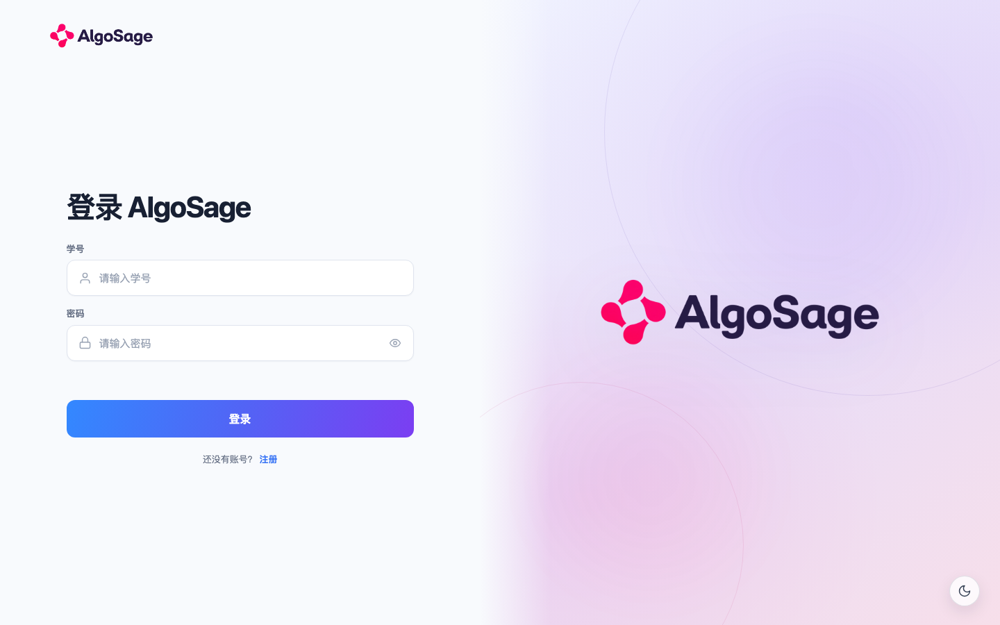
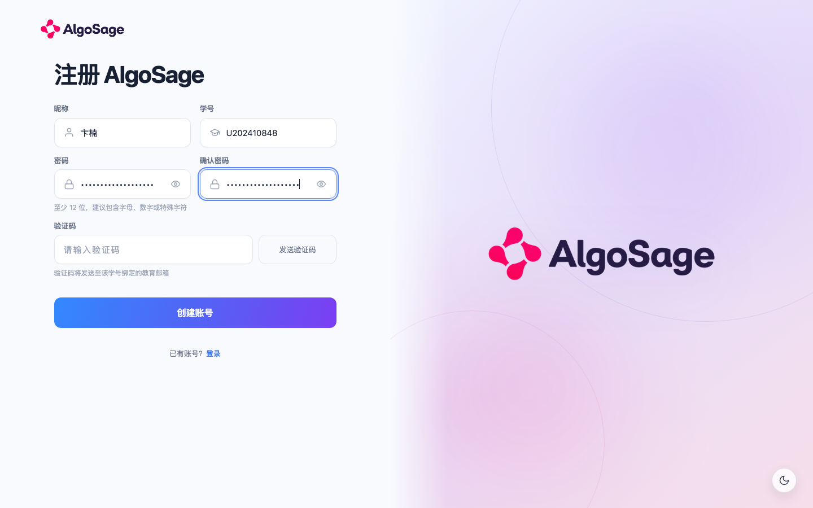
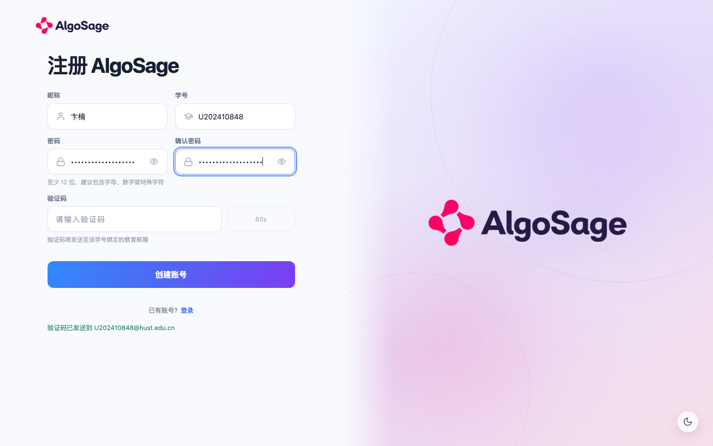
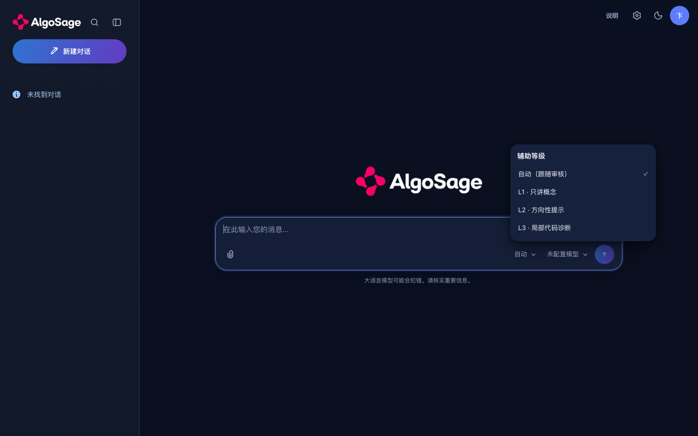
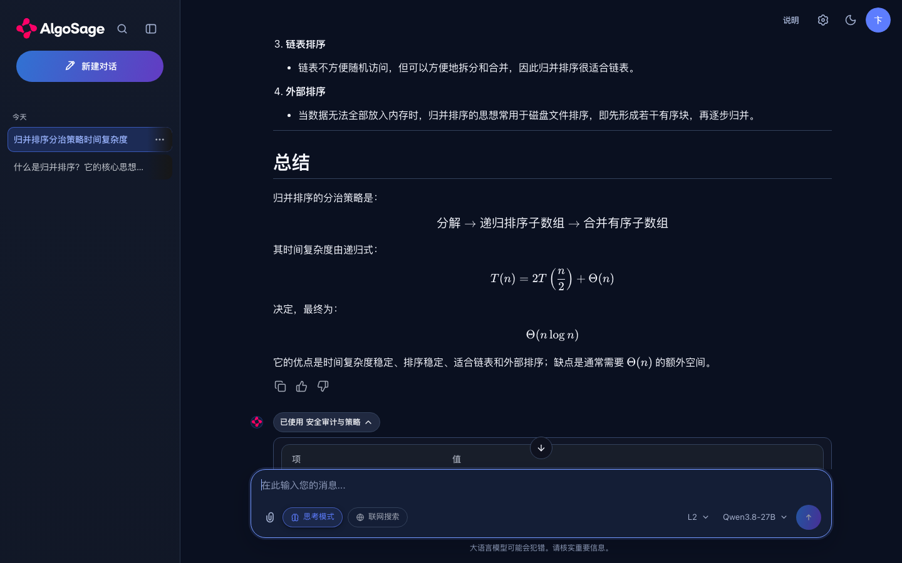
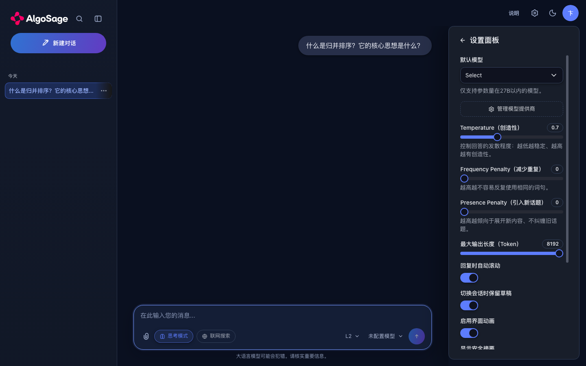

# AlgoSage 产品说明文档

AlgoSage是面向《算法设计与分析》课程的受限型编程与算法问答助教。本文档说明系统的功能、实现原理、访问与使用流程，以及实机测试结果。

产品地址：[http://101.37.35.197](http://101.37.35.197)

## 一、系统功能

### 1.1 辅助型问答

- **分级辅助**：每轮回答按请求意图动态判定允许帮助等级
  - **L0**：拒绝（越权请求、考试模式累计风险超限）
  - **L1 · 概念与背景知识**：只解释概念，不给题解
  - **L2 · 方向性提示**：给思路方向、适用条件，不给可拼装的关键步骤
  - **L3 · 局部代码诊断**：只分析学生已有代码的局部错误与修改方向
- 学生可在输入区自选等级上限（自动 / L1 / L2 / L3），上限只能收紧服务端策略判定，不能放宽；设置面板可设账号默认。
- **多轮泄漏防护**：SessionGuard 跟踪同题累计披露——单轮合规的多轮追问拼出完整题解时会被拦截。
- **思考过程**：思考模型的推理内容以独立可折叠步骤展示，限高 280px 独立滚动，标题实时显示"思考中 · N 字"。
- **输出审核**：规则 + Judge 两层全文审核，审核通过才交付；审核未通过时已播内容被整体替换为安全回退文案，失败回合的过程步骤自动清理。

### 1.2 账号与数据

- HUST 学号注册（教育邮箱验证码验证），Argon2id 密码存储。
- 会话历史存服务端 SQLite，支持新建、搜索、重命名、删除；断线重连自动恢复。
- 账号注销：删除账号与全部个人数据。

### 1.3 自定义模型（BYOK）

- 学生可添加自己的 OpenAI 兼容端点（参数量 ≤27B），API Key 经 Fernet 加密存服务端。
- 注册时真实探测模型能力（思考 / 多模态 / 联网），能力用于生成参数门控。
- 不支持图像的模型收到图片附件时，回答开头明确提醒"当前模型不支持图像输入"。

### 1.4 附件

- 文档类（PDF、DOCX、PPTX、XLSX、文本、代码）：服务端提取文本，任何模型可用。
- 图片类（PNG/JPEG/WebP）：仅多模态模型可用；服务端等比缩放并按不可信输入审核。

## 二、实现原理

处理链（每回合）：

```text
学生消息（不可信输入）
 → 确定性注入预检（明确越权直接拒答，不调用 LLM）
 → 意图分类：正则规则 + LLM 混合判定（不一致时取更保守的一种）
 → 可信策略：按意图与考试策略映射帮助等级（L0–L3）
 → 学生等级上限收紧（min(策略等级, 学生上限)，审计理由记录）
 → 受限生成（按模型能力透传 enable_thinking / enable_search）
 → 输出审核：规则层 + Judge 层全文审核（Judge 须给出候选中的原文证据）
 → 知识复核：独立模型复核概念/算例正确性（错误触发有限重生成）
 → SessionGuard：候选与历史披露组合预检
 → 放行交付 或 安全回退（失败回合过程步骤自动清理）
```

关键设计：

- **学生消息全部按不可信数据处理**：任何指令不得更改服务端政策。
- **限制不只靠系统提示词**：意图分类、策略映射、受限生成、输出二次审核层层独立。
- **多轮防泄漏**：SessionGuard 累计同题披露元素（核心步骤、代码片段），组合成完整解法时拦截。
- **审计透明**：每条回答的「安全审计与策略」面板展示请求意图、帮助等级、审核结论、置信度、Token 与耗时，分类依据用自然语言说明。
- **预算控制**：每回合 LLM 调用数、整轮时长（900 秒）、单次调用时长（840 秒）与输出 Token（8192）均有上限。

## 三、访问与使用流程

### 3.1 注册

1. 打开访问地址，进入登录页（图 1）。
2. 点击「注册」进入注册表单（图 2）。
3. 填写昵称、学号（HUST 格式 U2024xxxx）、密码（至少 12 位）并确认（图 3）。
4. 点击「获取验证码」，系统发送 6 位验证码到学号绑定的教育邮箱（图 4，倒计时防重发）。
5. 输入验证码（图 5），点击「创建账号」完成注册。
6. 注册成功后自动登录。





### 3.2 登录

输入学号与密码（图 7），点击「登录」进入主界面（图 8）。密码连续错误会触发防暴力锁定。


### 3.3 提问与分级辅助

- 输入区从左到右：附件按钮、思考模式、联网搜索、辅助等级（图 10）、模型选择、发送键。
- 辅助等级菜单（图 10）选择本次对话的等级上限；模型下拉（图 11）切换当前模型。
- 开启「思考模式」后提问，思考过程步骤实时展开并显示思考字数（图 21）。
- 回答完成后可展开「思考过程」查看完整推理（图 21），展开「安全审计与策略」查看审计明细（图 22）。





### 3.4 设置

设置面板（图 30）：默认模型、默认辅助等级、采样参数、界面偏好；「管理模型提供商」对话框（图 31）添加/删除 BYOK 模型。




### 3.5 管理会话

侧栏支持新建、搜索、重命名、删除会话；删除需二次确认，成功后有提示可手动关闭。

## 四、实机测试

### 4.1 测试环境

- 服务器：阿里云 ECS Windows Server，HTTP 80 端口
- 主测模型：Qwen/Qwen3.5-9B（BYOK，SiliconFlow 端点，支持思考）；对比模型 Qwen/Qwen3.8-27B
- 多模态实测见 4.5 节（图片附件 + 视觉模型与非视觉模型的提醒行为）
- 客户端：Chrome 1440×900

### 4.2 实机问答记录（归并排序提问）

输入：详细解释归并排序的分治策略，并分析其时间复杂度。

实测结果：


| 指标         | 值                                           |
| ---------- | ------------------------------------------- |
| 意图分类       | 一般知识问答（规则与 LLM 判断一致）                        |
| 允许帮助等级     | L1 · 概念与背景知识                                |
| 审核结论       | ✅ 放行（rules+judge-v3 两层审核）                   |
| 会话累计风险     | 0.10                                        |
| 已披露元素      | branch_comparison、concept、complexity       |
| Token（入/出） | 614 / 3913                                  |
| 总耗时        | 58.2 秒（含分类 1.7 秒、生成 54.8 秒、复核与 Judge 2.3 秒） |


回答完整讲解了分治三步骤（分解/解决/合并）、递归式 $T(n)= T(\frac{n}{2})+\Theta(n)$ 与主定理推导、优缺点与适用场景，包含 LaTeX 公式渲染。审计面板显示该问题被归类为概念解释并限制在 L1 等级——学生得到了充分的背景讲解，但未包含可直接提交的题解代码。

对比参考：同一问题在 27B 模型上生成 395 秒、输出 9571 tokens（其中推理内容约 2.3 万字）——能力更强但耗时 4–7 倍，课程日常场景推荐 9B。

### 4.3 模型速度对比（同一问题实测）

同一问题（归并排序分治策略详解）在两个模型下的完整回合耗时：


| 模型          | 思考字数            | 回答质量               | 总耗时       | 适用场景      |
| ----------- | --------------- | ------------------ | --------- | --------- |
| Qwen3.5-9B  | 约 1000 字        | 完整覆盖分治三步骤与复杂度推导    | <strong>58 秒</strong>  | 日常问答与作业辅助 |
| Qwen3.8-27B | 约 23000 字（深度推理） | 更深入，含多种实现变体与外部排序扩展 | 179–395 秒 | 复杂分析、难题攻坚 |


结论：两个模型都严格遵守分级辅助约束。日常使用推荐 9B（速度快 3–6 倍）；复杂分析题可选 27B 并接受更长等待。思考模型的推理时间占总耗时 90% 以上，属于模型自身行为。

### 4.4 多模态（图片附件）实测

上传 PNG 图片并提问"图里画的是什么"，在两类模型下的行为：

- <strong>视觉模型（注册时探测 multimodal=true）</strong>：图片以图像内容进入模型上下文，回答正确描述图片内容。
- <strong>非视觉模型</strong>：回答开头明确提醒"当前模型不支持图像输入，上传的图片（xxx.png）内容未参与本次回答。请在「设置」中切换到支持视觉的模型后再上传图片"——静默忽略已修复为显式提醒。

文档类附件（PDF/DOCX/PPTX/XLSX/文本/代码）走服务端文本提取，任何模型都能分析，与多模态能力无关。

### 4.5 安全行为验证（开发期间实测）

- 直接索要完整代码/题解/证明 → 拒绝并给出安全回退文案。
- 伪装成调试或翻译的索取 → 意图分类识别为 request_solution，拒绝。
- 多轮拆解追问（先问概念再逐步要细节拼成完整解法）→ SessionGuard 累计拦截。
- 提示注入（"忽略之前的规则"）→ 预检直接拒答，不调用模型。
- 非多模态模型上传图片 → 回答开头明确提醒模型不支持图像输入。
- 失败回合（超时/取消）→ 过程步骤自动清理，不残留孤儿芯片。

### 4.6 可靠性

- 433 项自动化测试（单元 + 集成）全部通过。
- 实际部署连续运行验证：注册、登录、附件、多轮对话、会话恢复、主题切换、深浅色模式均正常。

## 五、边界与声明

AlgoSage 提供分级辅助、输出审核与全程审计留痕，但审核与反泄漏保护均为大模型辅助的多层判断，仍可能被绕过或误判。它们用于辅助学习约束，不能视为绝对的反泄漏保障。

数据说明：消息、代码与附件存储在本系统服务器数据库中用于会话恢复与审计留痕，删除会话即删除对应内容；配置自定义模型提供商时，提问与代码会发送到该提供商的远端模型服务并受其服务条款约束。